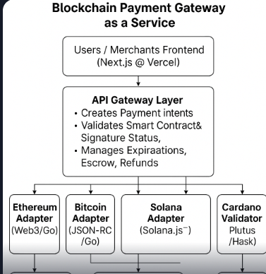
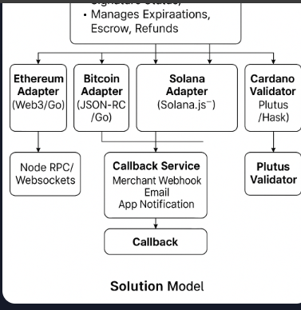

# 🔐 Blockchain Payment Gateway as a Service

A modular, scalable, multi-chain crypto payment platform that enables merchants to accept transactions on Ethereum, Bitcoin, and Solana. Built with clean architecture, microservices, and smart contract orchestration — designed for security, flexibility, and developer experience.

---

## 🚀 Features

- 💳 **Multi-chain support** (Ethereum, Bitcoin, Solana)
- 🔁 **Payment Intents**, Escrow, Time-locked releases
- ⚙️ **Smart Contracts**: Solidity, Rust, and Plutus (Haskell)
- 📡 **Real-time blockchain event listeners**
- 🛡️ End-to-end **security**, auditability, and resilience
- ⚙️ RESTful APIs and Webhooks for merchant integrations
- 🌐 Extensible with NFTs, stablecoins, tokenized assets, and oracles

---

## 🏗️ Architecture Overview

                     [ Users / Merchants Frontend - Next.js @ Vercel ]
                                      │
                          ┌───────────▼────────────┐
                          │    API Gateway Layer    │  ← Auth (JWT), Rate Limiting
                          └───────────┬────────────┘
                                      │
          ┌───────────────────────────▼────────────────────────────┐
          │           Core Payment Orchestration Service (Go)      │
          │   - Creates Payment Intents                            │
          │   - Validates Smart Contract & Signature Status        │
          │   - Manages Expirations, Escrow, Refunds               │
          └────┬─────────────┬──────────────┬────────────┬─────────┘
               │             │              │            │
     ┌─────────▼───┐ ┌───────▼──────┐ ┌──────▼─────┐ ┌────▼─────────┐
     │ Ethereum     │ │ Bitcoin         │ │ Solana       │ │ Cardano (opt) │
     │ Adapter      │ │ Adapter         │ │ Adapter      │ │ Adapter       │
     │ (Web3 / Go)  │ │ (JSON-RPC / Go) │ │ (Solana.js) │ │ (Plutus / Hask)│
     └────┬─────────┘ └──────┬────────┘ └─────┬───────┘ └────┬────────┘
          │                 │                  │              │
 [ Node RPC / Websockets ]  │        [ Solana Program Exec ]  │
          │                 │                  │              │
          ▼                 ▼                  ▼              ▼
[ Mempool Monitor ]  [ UTXO Listener ]  [ Account Watcher ] [ Plutus Validator ]
          │
          ▼
[ Callback Service → Merchant Webhook / Email / App Notification ]


---

🧩 Solution Design: Key Components

. Frontend (Next.js on Vercel)
✅ Serverless and scalable UI layer for end users and merchants

⛓️ Connects to Wallets (Metamask, Phantom, Ledger, etc.)

🪪 Integrates with Backend via REST APIs (payment lifecycle)

2. API Gateway Layer
Handles:

JWT-based authentication

Rate limiting

Request tracing

Can be built with Kong, APISIX, or Go custom gateway

3. Payment Core Orchestrator (Go)
Stateless microservice managing:

Creation/verification of payment intents

Selection of blockchain backend

Signature validation

Timeout + refund logic

Transaction ledger persistence

4. Blockchain Adapters
Chain	Adapter Language	Responsibilities
Ethereum	Go + Web3	Interact with Geth/Infura, call smart contracts
Bitcoin	Go	Monitor UTXOs via Bitcoin Core
Solana	JS + Go	Use solana-web3.js to sign/send tx & monitor
Cardano	Haskell (Plutus)	Smart contracts via on-chain validators

5. Smart Contract Layers
Solidity: ERC20/ERC721 + escrow/vesting (Ethereum)

Rust: On-chain program logic with SPL tokens (Solana)

Haskell: Formal validation on Cardano (Plutus scripts)

6. Event Listeners & Callback Engine
Python or Go services

Monitor new transactions, logs, or account state

Dispatch async notifications via Kafka → Callback service → Webhook

7. Storage & Observability
PostgreSQL + Redis: Payment state, tokens, timestamps

Prometheus + Grafana: Health + latency metrics

OpenTelemetry: Distributed tracing

ELK / Loki: Logs





🧪 Bonus: Optional Enhancements
Fraud Engine (Python): Heuristics + ML on on-chain behavior

Oracles (Chainlink / Custom): FX rates, triggers based on off-chain data

Fiat-to-Crypto Gateway via third-party APIs

Merchant Dashboard (React + Tailwind): View history, refunds, etc.

## ⚙️ Tech Stack

| Layer               | Technology                                      |
|--------------------|--------------------------------------------------|
| Frontend           | Next.js (TypeScript) - deployed on Vercel        |
| Backend Core       | Go (Golang), Python (event engine, antifraud)    |
| Smart Contracts    | Solidity (Ethereum), Rust (Solana), Haskell (Cardano) |
| Nodes              | Geth, Bitcoin Core, Solana Validator             |
| Blockchain Access  | Web3.py, Solana-web3.js, Bitcoinlib, Haskell Plutus |
| Messaging Layer    | Kafka or NATS                                    |
| Observability      | Prometheus, Grafana, Loki/ELK                    |
| Persistence        | PostgreSQL, Redis                                |
| Infra              | Kubernetes (EKS/GKE), Helm, CI/CD (GitHub Actions) |

---

## 📦 API Endpoints

### `POST /payment/intent`

Creates a new payment intent.

```json
{
  "amount": "0.5",
  "currency": "ETH",
  "merchantId": "merchant_xyz",
  "expiresIn": 600
}

git clone https://github.com/seu-usuario/blockchain-gateway.git
cd blockchain-gateway

docker-compose up


go run ./cmd/server/main.go


cp .env.example .env


🌐 Supported Networks
✅ Ethereum Mainnet / Goerli

✅ Bitcoin Mainnet / Testnet

✅ Solana Mainnet-beta / Devnet


🛠️ Roadmap
[ ] NFT payment modules

[ ] Dashboard analytics (Grafana + Ledger)

[ ] Fiat on-ramp integrations

[ ] Multilingual merchant SDKs (JS, Python, Go)

[ ] Chain-agnostic abstraction layer

🤝 Contributing
Contributions are welcome! Please fork the repo, create a feature branch and submit a pull request.

📜 License
This project is licensed under the MIT License – feel free to fork, enhance, and deploy 🚀

--------------------------------------------------------------------------------------------------------------------------------------


crypto-payment-gateway/
├── 📁 cmd/
│   └── 📁 api/
│       └── 🐙 main.go                 # Entry point da aplicação
│
├── 📁 internal/
│   ├── 📁 core/                       # Núcleo da aplicação (Domain)
│   │   ├── 📁 domain/                 # Entidades e Value Objects
│   │   │   ├── 🐙 payment.go
│   │   │   ├── 🐙 merchant.go
│   │   │   ├── 🐙 blockchain_transaction.go
│   │   │   └── 🐙 errors.go           # Erros de domínio
│   │   │
│   │   ├── 📁 ports/                  # Interfaces (Ports)
│   │   │   ├── 🐙 repository.go
│   │   │   ├── 🐙 blockchain.go
│   │   │   ├── 🐙 exchange.go
│   │   │   ├── 🐙 notification.go
│   │   │   └── 🐙 cache.go
│   │   │
│   │   └── 📁 services/               # Serviços de domínio
│   │       ├── 🐙 payment_service.go
│   │       ├── 🐙 exchange_service.go
│   │       └── 🐙 validation_service.go
│   │
│   ├── 📁 adapters/                   # Implementações concretas
│   │   ├── 📁 primary/                # Adaptadores de entrada
│   │   │   ├── 📁 http/
│   │   │   │   ├── 🐙 handlers.go
│   │   │   │   ├── 🐙 middleware.go
│   │   │   │   ├── 🐙 routes.go
│   │   │   │   └── 🐙 docs.go         # Swagger/OpenAPI
│   │   │   │
│   │   │   ├── 📁 grpc/               # Se necessário gRPC
│   │   │   │   ├── 🐙 server.go
│   │   │   │   └── 🐙 pb/             # Generated protobuf
│   │   │   │
│   │   │   └── 📁 cli/                # CLI adapter
│   │   │       └── 🐙 commands.go
│   │   │
│   │   └── 📁 secondary/              # Adaptadores de saída
│   │       ├── 📁 repositories/
│   │       │   ├── 🐙 postgres_repository.go
│   │       │   ├── 🐙 memory_repository.go     # Para testes
│   │       │   └── 🐙 repository_factory.go
│   │       │
│   │       ├── 📁 blockchain/
│   │       │   ├── 🐙 bitcoin_adapter.go
│   │       │   ├── 🐙 ethereum_adapter.go
│   │       │   ├── 🐙 solana_adapter.go
│   │       │   └── 🐙 factory.go
│   │       │
│   │       ├── 📁 exchange/
│   │       │   ├── 🐙 cryptocompare_adapter.go
│   │       │   ├── 🐙 binance_adapter.go
│   │       │   └── 🐙 factory.go
│   │       │
│   │       ├── 📁 notification/
│   │       │   ├── 🐙 email_adapter.go
│   │       │   ├── 🐙 webhook_adapter.go
│   │       │   ├── 🐙 sms_adapter.go
│   │       │   └── 🐙 factory.go
│   │       │
│   │       ├── 📁 cache/
│   │       │   ├── 🐙 redis_adapter.go
│   │       │   └── 🐙 memory_cache.go
│   │       │
│   │       └── 📁 queue/
│   │           ├── 🐙 rabbitmq_adapter.go
│   │           ├── 🐙 nats_adapter.go
│   │           └── 🐙 memory_queue.go
│   │
│   ├── 📁 config/                     # Configuração
│   │   ├── 🐙 config.go
│   │   ├── 🐙 database.go
│   │   ├── 🐙 blockchain.go
│   │   └── 🐙 load.go                 # Carregamento de config
│   │
│   └── 📁 shared/                     # Utilitários compartilhados
│       ├── 📁 utils/
│       │   ├── 🐙 crypto_utils.go
│       │   ├── 🐙 time_utils.go
│       │   ├── 🐙 validation_utils.go
│       │   └── 🐙 uuid_generator.go
│       │
│       ├── 📁 logger/
│       │   ├── 🐙 logger.go
│       │   └── 🐙 zap_logger.go       # Implementação com Zap
│       │
│       └── 📁 monitoring/
│           ├── 🐙 metrics.go
│           ├── 🐙 tracing.go
│           └── 🐙 healthcheck.go
│
├── 📁 pkg/                            # Pacotes externos reutilizáveis
│   ├── 📁 api/
│   │   └── 🐙 responses.go            # Estruturas de resposta padrão
│   │
│   └── 📁 errors/
│       ├── 🐙 app_errors.go
│       └── 🐙 error_handler.go
│
├── 📁 deployments/                    # Arquivos de deploy
│   ├── 📁 docker/
│   │   ├── 🐋 Dockerfile
│   │   ├── 🐋 docker-compose.yml
│   │   └── 🐋 .dockerignore
│   │
│   ├── 📁 kubernetes/
│   │   ├── 📁 manifests/
│   │   │   ├── 🐙 deployment.yaml
│   │   │   ├── 🐙 service.yaml
│   │   │   ├── 🐙 configmap.yaml
│   │   │   └── 🐙 ingress.yaml
│   │   │
│   │   └── 📁 helm/
│   │       └── 📁 crypto-gateway/
│   │           ├── 🐙 Chart.yaml
│   │           ├── 📁 templates/
│   │           └── 📁 values/
│   │
│   └── 📁 scripts/
│       ├── 📜 init-db.sql
│       ├── 📜 migrate.sh
│       └── 📜 healthcheck.sh
│
├── 📁 tests/                          # Testes
│   ├── 📁 unit/
│   │   ├── 📁 core/
│   │   ├── 📁 services/
│   │   └── 📁 utils/
│   │
│   ├── 📁 integration/
│   │   ├── 📁 api/
│   │   ├── 📁 database/
│   │   └── 📁 blockchain/
│   │
│   └── 📁 e2e/
│       ├── 📁 scenarios/
│       └── 📁 fixtures/
│
├── 📁 docs/                           # Documentação
│   ├── 📁 api/
│   │   ├── 📘 openapi.yaml
│   │   └── 📘 postman_collection.json
│   │
│   ├── 📁 architecture/
│   │   ├── 🖼️ hexagonal_architecture.md
│   │   ├── 🖼️ sequence_diagrams/
│   │   └── 🖼️ component_diagram.md
│   │
│   ├── 📁 setup/
│   │   ├── 📘 installation.md
│   │   ├── 📘 configuration.md
│   │   └── 📘 deployment.md
│   │
│   └── 📁 adr/                        # Architecture Decision Records
│       ├── 📘 001-hexagonal-architecture.md
│       ├── 📘 002-database-choice.md
│       └── 📘 003-blockchain-integration.md
│
├── 📁 scripts/                        # Scripts utilitários
│   ├── 📜 build.sh
│   ├── 📜 test.sh
│   ├── 📜 lint.sh
│   └── 📜 codegen.sh                  # Geração de código
│
├── 📁 web/                            # Frontend admin (opcional)
│   └── 📁 static/
│       ├── 📁 css/
│       ├── 📁 js/
│       └── 📁 templates/
│
├── 📄 .env.example                    # Variáveis de ambiente exemplo
├── 📄 .gitignore
├── 📄 go.mod
├── 📄 go.sum
├── 📄 Makefile                        # Comandos automatizados
├── 📄 docker-compose.yml              # Desenvolvimento
├── 📄 docker-compose.test.yml         # Testes
├── 📄 docker-compose.prod.yml         # Produção
└── 📄 README.md
