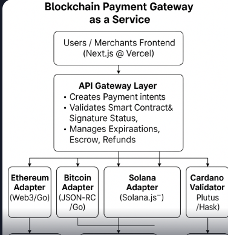
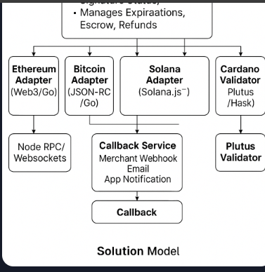

# 🔐 Blockchain Payment Gateway as a Service

A modular, scalable, multi-chain crypto payment platform that enables merchants to accept transactions on Ethereum, Bitcoin, and Solana. Built with clean architecture, microservices, and smart contract orchestration — designed for security, flexibility, and developer experience.

---

## 🚀 Features

- 💳 **Multi-chain support** (Ethereum, Bitcoin, Solana, Cardano)
- 🔁 **Payment Intents**, Escrow, Time-locked releases
- ⚙️ **Smart Contracts**: Solidity, Rust, and Plutus (Haskell)
- 📡 **Blockchain watchers, confirmation workers and signed inbound notifications**
- 🛡️ End-to-end **security**, auditability, and resilience
- ⚙️ RESTful APIs and Webhooks for merchant integrations
- 🌐 Extensible with NFTs, stablecoins, tokenized assets, and oracles

---

## 🏗️ Architecture Overview


---------------------------------------------------------------------------------------------------------------------------------

                     [ Users / Merchants Frontend - Next.js @ Vercel ]
                                      │
                          ┌───────────▼────────────┐
                          │    API Gateway Layer    │  ← Auth (JWT), Rate Limiting
                          └───────────┬────────────┘
                                      │
          ┌───────────────────────────▼────────────────────────────┐
          │           Core Payment Orchestration Service (Go)      │
          │   - Creates Payment Intents                            │
          │   - Validates Smart Contract & Signature Status        │
          │   - Manages Expirations, Escrow, Refunds               │
          └────┬─────────────┬──────────────┬────────────┬─────────┘
               │             │              │            │
     ┌─────────▼───┐ ┌───────▼──────┐ ┌──────▼─────┐ ┌────▼─────────┐
     │ Ethereum     │ │ Bitcoin         │ │ Solana       │ │ Cardano (opt) │
     │ Adapter      │ │ Adapter         │ │ Adapter      │ │ Adapter       │
     │ (Web3 / Go)  │ │ (JSON-RPC / Go) │ │ (Solana.js) │ │ (Plutus / Hask)│
     └────┬─────────┘ └──────┬────────┘ └─────┬───────┘ └────┬────────┘
          │                 │                  │              │
 [ Node RPC / Websockets ]  │        [ Solana Program Exec ]  │
          │                 │                  │              │
          ▼                 ▼                  ▼              ▼
[ Mempool Monitor ]  [ UTXO Listener ]  [ Account Watcher ] [ Plutus Validator ]
          │
          ▼
[ Callback Service → Merchant Webhook / Email / App Notification ]


---

🧩 Solution Design: Key Components

. Frontend (Next.js on Vercel)
✅ Serverless and scalable UI layer for end users and merchants

⛓️ Connects to Wallets (Metamask, Phantom, Ledger, etc.)

🪪 Integrates with Backend via REST APIs (payment lifecycle)

2. API Gateway Layer
Handles:

JWT-based authentication

Rate limiting

Request tracing

Can be built with Kong, APISIX, or Go custom gateway

3. Payment Core Orchestrator (Go)
Stateless microservice managing:

Creation/verification of payment intents

Selection of blockchain backend

Signature validation

Timeout + refund logic

Transaction ledger persistence

4. Blockchain Adapters
Chain	Adapter Language	Responsibilities
Ethereum	Go + Web3	Interact with Geth/Infura, call smart contracts
Bitcoin	Go	Monitor UTXOs via Bitcoin Core
Solana	JS + Go	Use solana-web3.js to sign/send tx & monitor
Cardano	Haskell (Plutus)	Smart contracts via on-chain validators

5. Smart Contract Layers
Solidity: ERC20/ERC721 + escrow/vesting (Ethereum)

Rust: On-chain program logic with SPL tokens (Solana)

Haskell: Formal validation on Cardano (Plutus scripts)

6. Event Listeners & Callback Engine
Python or Go services

Monitor new transactions, logs, or account state

Dispatch async notifications via Kafka → Callback service → Webhook

7. Storage & Observability
PostgreSQL + Redis: Payment state, tokens, timestamps

Prometheus + Grafana: Health + latency metrics

OpenTelemetry: Distributed tracing

ELK / Loki: Logs





🧪 Bonus: Optional Enhancements
Fraud Engine (Python): Heuristics + ML on on-chain behavior

Oracles (Chainlink / Custom): FX rates, triggers based on off-chain data

Fiat-to-Crypto Gateway via third-party APIs

Merchant Dashboard (React + Tailwind): View history, refunds, etc.

## ⚙️ Tech Stack

| Layer              | Technology in this repository |
| ------------------ | ----------------------------- |
| Frontend           | Static HTML/JS merchant dashboard |
| Backend Core       | Go (stdlib `net/http`, `log/slog`) |
| Smart Contracts    | Solidity, Rust (Anchor), Haskell (Plutus) reference contracts |
| Blockchain Access  | Direct JSON-RPC / REST adapters, mock simulator |
| Messaging Layer    | In-memory queue behind a `Queue` port (Kafka/NATS ready) |
| Observability      | Prometheus metrics + structured logs |
| Persistence        | PostgreSQL + Redis, with in-memory fallbacks |
| Infra              | Docker Compose, Kubernetes manifest, Makefile |

---

## ✅ Running this implementation

The Go service in this repository implements the payment core, chain adapters,
escrow, fraud checks, webhooks, persistence, metrics and a local dashboard.

```bash
cp .env.example .env
# local development: simulate chains, use in-memory storage
BLOCKCHAIN_MOCK=true DATABASE_DRIVER=memory CACHE_DRIVER=memory go run ./cmd serve
# dashboard: http://localhost:8080
```

Production-style stack with PostgreSQL, Redis, Prometheus and Grafana:

```bash
make docker-up
```

### CLI

```bash
go run ./cmd migrate
go run ./cmd merchant create --name "Acme" --email merchant@example.com
go run ./cmd merchant list
go run ./cmd payment list --merchant merchant@example.com
go run ./cmd payment get --id <uuid>
```

### API

| Method | Path | Description |
| --- | --- | --- |
| `POST` | `/v1/merchants/register` | Register a merchant and receive an API key |
| `POST` | `/v1/auth/login` | Exchange an API key for a JWT |
| `GET` | `/v1/merchant` | Current merchant profile |
| `PATCH` | `/v1/merchant/webhook` | Update webhook URL |
| `POST` | `/v1/merchant/rotate-key` | Rotate API key |
| `POST` | `/v1/payments` | Create a payment intent |
| `GET` | `/v1/payments` | List payment intents |
| `GET` | `/v1/payments/{id}` | Get a payment intent |
| `POST` | `/v1/payments/{id}/confirm` | Confirm a transaction hash |
| `POST` | `/v1/payments/{id}/cancel` | Cancel an unpaid intent |
| `POST` | `/v1/payments/{id}/refund` | Refund a succeeded payment |
| `POST` | `/v1/escrows` | Create a time-locked escrow |
| `GET` | `/v1/escrows` | List escrows |
| `GET` | `/v1/escrows/{id}` | Get an escrow |
| `POST` | `/v1/escrows/{id}/release` | Release escrow funds |
| `POST` | `/v1/escrows/{id}/refund` | Refund escrow funds |
| `POST` | `/v1/escrows/{id}/cancel` | Cancel an escrow |
| `GET` | `/v1/webhooks/deliveries` | List webhook delivery attempts |
| `POST` | `/v1/webhooks/test` | Send a test webhook |
| `POST` | `/v1/webhooks/blockchain` | Signed inbound chain notification |
| `GET` | `/v1/audit-logs` | Merchant audit trail |
| `GET` | `/v1/chains`, `/v1/rates` | Supported chains and exchange rates |
| `GET` | `/healthz`, `/readyz`, `/metrics` | Health and Prometheus metrics |

Full API contract: [`docs/openapi.yaml`](docs/openapi.yaml).
Architecture and security notes: [`docs/ARCHITECTURE.md`](docs/ARCHITECTURE.md).
Webhook signing: [`docs/WEBHOOKS.md`](docs/WEBHOOKS.md).

### Example

```bash
curl -X POST http://localhost:8080/v1/merchants/register \
  -H 'Content-Type: application/json' \
  -d '{"name":"Acme","email":"merchant@example.com"}'

curl -X POST http://localhost:8080/v1/payments \
  -H "X-API-Key: pk_test_..." \
  -H 'Content-Type: application/json' \
  -d '{"amount":"0.5","currency":"ETH","blockchain":"ethereum","network":"sepolia"}'
```

---

## 🌐 Supported Networks

- Ethereum Mainnet / Goerli / Sepolia
- Bitcoin Mainnet / Testnet / Signet / Regtest
- Solana Mainnet-beta / Devnet
- Cardano Mainnet / Testnet (Blockfrost-compatible API)
- Any chain through the mock adapter for local development

## 🛠️ Roadmap

- [x] Chain-agnostic adapter layer
- [x] Payment intents, escrow and signed webhooks
- [x] Prometheus metrics and health probes
- [ ] Grafana dashboard bundle
- [ ] NFT payment modules
- [ ] Fiat on-ramp integrations
- [ ] Multilingual merchant SDKs (JS, Python, Go)
- [ ] gRPC transport and Kafka/NATS queue adapters
- [ ] KMS/HSM or custody-provider signing integration

🤝 Contributing
Contributions are welcome! Please fork the repo, create a feature branch and submit a pull request.

📜 License
This project is licensed under the MIT License – feel free to fork, enhance, and deploy 🚀

--------------------------------------------------------------------------------------------------------------------------------------

## 📁 Repository Layout

```text
cmd/main.go                         process entrypoint
internal/app/                       wiring, HTTP server, worker lifecycle
internal/config/                    environment configuration
internal/core/domain/               entities, value objects, ports
internal/core/services/             payment, escrow, webhook, fraud use cases
internal/core/adapters/primary/     HTTP handlers/middleware and CLI
internal/core/adapters/secondary/   Postgres/memory, chains, exchanges, cache, queue
internal/workers/                   expiration, confirmations, watcher, callbacks, escrow
internal/shared/                    logger, metrics, health, crypto/JWT utilities
pkg/                                public response/error helpers
web/index.html                      local merchant dashboard
contracts/                          reference Solidity/Rust/Plutus contracts
docs/                               architecture, webhooks, OpenAPI
deployments/                        Dockerfile, Compose, Prometheus, Kubernetes
```

```bash
make build      # compile to bin/payment-gateway
make test       # go test ./...
make lint       # go vet ./...
make docker-up  # full local stack (gateway + Postgres + Redis + Prometheus + Grafana)
```
